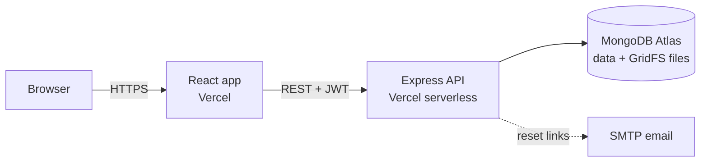

<div align="center">

# MCPCMS

### Multi-Company Payroll & Compliance Management System

A full-stack HR and payroll platform for running salaries, attendance, leave, reimbursements and statutory compliance across multiple companies, with a self-service portal for employees.

[](https://nodejs.org/)
[](https://react.dev/)
[](https://expressjs.com/)
[](https://www.mongodb.com/)
[](https://vercel.com/)

<!-- Replace the link below with your Vercel frontend URL after deploying -->
**[🔗 Live Demo](https://your-app.vercel.app)** · [Demo Accounts](#-try-the-live-demo) · [Features](#-features) · [Run Locally](#-getting-started) · [Deploy](#%EF%B8%8F-deployment-vercel--mongodb-atlas)

</div>

---

## 🔑 Try the Live Demo

The live demo comes with a ready-made company, **Demo Corp**, filled with eight employees, three months of attendance, payroll history with payslips, leave requests, reimbursement claims and compliance records.

| Role | Sign in at | Email / ID | Password |
|---|---|---|---|
| **Company Admin** | Company login | `admin@democorp.example` | `Demo@1234` |
| **HR** | Company login | `hr@democorp.example` | `Demo@1234` |
| **Employee** | Employee login | `employee@democorp.example` | `Demo@1234` |

> [!NOTE]
> These are shared accounts. You can try every feature (add employees, mark attendance, approve leave, run payroll, download payslips and reports), but changing the demo accounts' passwords or emails, or deleting them, is disabled so the demo keeps working for everyone. The demo data is reset periodically.

---

## 📖 Overview

MCPCMS gives each company its own isolated workspace for HR and payroll operations, while a platform owner (Super Admin) onboards and manages the companies.

- **Companies** manage employees, attendance, leave, requests, reimbursements, payroll, compliance, analytics and reports.
- **Employees** use a self-service portal to view attendance and payslips, apply for leave, raise requests and submit expense claims.
- **Data isolation** is enforced on every API request: users only ever see their own company's data.

---

## ✨ Features

**Payroll**
- One-click monthly payroll with **loss-of-pay** handling: the full month is paid, minus recorded absences (Absent = 1 day, Half-Day = ½ day, approved Unpaid leave = 1 day per day)
- Automatic **PF** (12% of basic, capped at ₹1,800), **ESI** (0.75% when gross ≤ ₹21,000) and **TDS**
- Branded **PDF payslips**, generated when payroll runs and stored in the database, so issued payslips never change afterwards
- Payroll statuses (Processed / Paid / Hold); paid salaries are protected from accidental re-runs

**People & Attendance**
- Employee directory with bank and statutory details, plus **CSV bulk import**
- Daily and bulk attendance marking (Present, Absent, Half-Day, Leave, Holiday, WFH), locked once recorded
- Leave applications and approvals, employee requests (WFH, shift change, attendance correction, resignation)
- **Reimbursement claims** with bill uploads (PDF/images, stored in MongoDB)

**Compliance & Insights**
- Monthly statutory checklist (PF, ESI, TDS, Professional Tax, Minimum Wage, LWF) with auto-validation against payroll
- Analytics dashboard: payroll trends, department-wise salary, attendance and compliance summaries
- **Excel exports** for payroll and attendance

**Accounts & Security**
- JWT authentication with role-based access control and strict per-company data isolation
- Company admins manage their **HR team**; HR and admins set employee login passwords
- **Forgot password** via emailed reset link, **change password**, and **profile editing** for every user
- Changing or resetting a password signs out the account's other sessions
- In-app notifications for payslips, salary payments, and leave, request and claim decisions

---

## 👥 Roles & Permissions

| Capability | Super Admin | Company Admin | HR | Employee |
|---|:---:|:---:|:---:|:---:|
| Create, edit and delete companies | ✅ | | | |
| Manage company admin accounts | ✅ | | | |
| Manage the HR team | | ✅ | | |
| Edit company details | | ✅ | | |
| Employees, attendance, leave, requests, claims | | ✅ | ✅ | |
| Payroll, payslips, compliance, analytics, reports | | ✅ | ✅ | |
| Self-service portal (payslips, leave, claims) | | | | ✅ |
| Edit own profile and password | ✅ | ✅ | ✅ | ✅ |

> The Super Admin manages companies and their admin logins only. It cannot see employees, payroll or any other company data.

---

## 🛠️ Tech Stack

| Layer | Technology |
|---|---|
| Frontend | React 18, React Router 6, Axios |
| Backend | Node.js, Express 4 |
| Database | MongoDB with Mongoose; files (bills, payslips) stored in **GridFS** |
| Auth | JSON Web Tokens, bcrypt |
| Documents | PDFKit (payslips), ExcelJS (reports) |
| Email | Nodemailer (password reset, contact form) |
| Hosting | Vercel (frontend + serverless API), MongoDB Atlas |



---

## 📁 Project Structure

```
mcpcms/
├── backend/
│   ├── api/index.js         # Vercel serverless entry point
│   ├── app.js               # Express app (routes, middleware)
│   ├── server.js            # Local server entry point
│   ├── config/              # Database connection
│   ├── controllers/         # Request handlers
│   ├── middleware/          # Auth, roles, uploads
│   ├── models/              # Mongoose schemas
│   ├── routes/              # API routes
│   ├── services/            # Payroll engine, payslips, storage, email
│   ├── scripts/seedDemo.js  # Creates / resets the demo company
│   └── vercel.json
└── frontend/
    ├── src/
    │   ├── components/      # Navbar, dialogs, route guards
    │   ├── context/         # Auth state
    │   ├── pages/           # Screens for every role
    │   ├── services/api.js  # API client
    │   └── utils/
    └── vercel.json
```

---

## 🚀 Getting Started

### Prerequisites

- [Node.js](https://nodejs.org/) 18 or later
- [MongoDB](https://www.mongodb.com/try/download/community) running locally, or a free [MongoDB Atlas](https://www.mongodb.com/atlas) cluster

### 1. Clone and install

```bash
git clone https://github.com/<your-username>/mcpcms.git
cd mcpcms
cd backend && npm install
cd ../frontend && npm install
```

### 2. Configure the backend

Copy `backend/.env.example` to `backend/.env` and fill in your values (see [Environment Variables](#%EF%B8%8F-environment-variables)). At minimum, set `MONGO_URI`, `JWT_SECRET` and your own private Super Admin login (`SEED_SUPER_ADMIN_EMAIL` / `SEED_SUPER_ADMIN_PASSWORD`).

### 3. Start the app

```bash
# terminal 1
cd backend
npm start            # API on http://localhost:5000

# terminal 2
cd frontend
npm start            # app on http://localhost:3000
```

On first start the backend creates your Super Admin account from the `SEED_SUPER_ADMIN_*` values. Sign in with it to create companies.

### 4. (Optional) Load the demo company

```bash
cd backend
npm run seed:demo
```

This creates **Demo Corp** with sample data and the [demo accounts](#-try-the-live-demo) shown above. Run it again at any time to reset the demo. It only touches the demo company.

---

## ⚙️ Environment Variables

**Backend** (`backend/.env`)

| Variable | Required | Description |
|---|:---:|---|
| `MONGO_URI` | ✅ | MongoDB connection string |
| `JWT_SECRET` | ✅ | Long random string used to sign login tokens |
| `SEED_SUPER_ADMIN_NAME` | | Super Admin display name |
| `SEED_SUPER_ADMIN_EMAIL` | ✅ | Super Admin email, used on first start only. Keep it private |
| `SEED_SUPER_ADMIN_PASSWORD` | ✅ | Super Admin password, used on first start only. Keep it private |
| `SEED_SUPER_ADMIN_RESET` | | Set to `true` for one start to restore the Super Admin from the values above (account recovery) |
| `FRONTEND_URL` | ✅ in production | Frontend URL, used in password reset links |
| `CORS_ORIGIN` | ✅ in production | Allowed frontend origin(s), comma-separated |
| `EMAIL_USER` / `EMAIL_PASS` | | Gmail address and [app password](https://support.google.com/accounts/answer/185833) for reset emails and the contact form |
| `EMAIL_DEV_LOG` | | `true` prints emails (including reset links) to the console instead of sending them, for local development |
| `DEMO_PASSWORD` | | Password for the demo accounts created by `npm run seed:demo` (default `Demo@1234`) |
| `PORT` | | Local API port (default `5000`) |

**Frontend** (`frontend/.env`)

| Variable | Description |
|---|---|
| `REACT_APP_API_URL` | API base URL, e.g. `http://localhost:5000/api` or `https://your-api.vercel.app/api` |

> [!IMPORTANT]
> Never commit `.env` files. Both are listed in `.gitignore`. The Super Admin login is for you only and should never appear in this README or be shared.

---

## ☁️ Deployment (Vercel + MongoDB Atlas)

The repository deploys as **two Vercel projects** from the same repo, both on the free tier.

**1. Database:** create a free MongoDB Atlas cluster, add a database user, allow network access from `0.0.0.0/0` (Vercel uses dynamic IPs), and copy the connection string.

**2. Backend (API):**
- In Vercel choose **Add New → Project**, import the repo and set **Root Directory** to `backend`.
- Add the backend environment variables: `MONGO_URI`, `JWT_SECRET`, `SEED_SUPER_ADMIN_*`, and `EMAIL_*` if you want reset emails.
- Deploy, then note the URL, e.g. `https://mcpcms-api.vercel.app`.

**3. Frontend:**
- Add another project from the same repo with **Root Directory** set to `frontend`. Vercel detects Create React App.
- Set `REACT_APP_API_URL` to `https://<your-api>.vercel.app/api` and deploy.

**4. Connect them:**
- In the backend project, set `CORS_ORIGIN` and `FRONTEND_URL` to the frontend URL, then redeploy the backend.

**5. Load the demo:**
- Locally, set `MONGO_URI` in `backend/.env` to the Atlas string and run `npm run seed:demo`.

**6. Publish the link:**
- Put the frontend URL in the [Live Demo](#-try-the-live-demo) link at the top of this README and in the repository's **About** section.

> [!TIP]
> Re-run `npm run seed:demo` against the production database whenever you want to refresh the public demo.

---

## 🧮 Payroll Rules

| Item | Rule |
|---|---|
| Working days | 26 per month |
| Paid days | 26 minus loss-of-pay days. Unmarked days are paid |
| Loss of pay | Absent = 1 day, Half-Day = ½ day, approved Unpaid leave = 1 day per day |
| Gross | (Basic + HRA + Allowances + Medical + Travel) × paid days / 26 |
| PF | 12% of basic, capped at ₹1,800 per month |
| ESI | 0.75% of gross, when gross ≤ ₹21,000 |
| TDS | 10% of the monthly amount above ₹2,50,000 / 12 (simplified) |
| Net pay | Gross − PF − ESI − TDS − fixed deductions |

---

## 📡 API Overview

All endpoints are under `/api` and, except login, password reset and the contact form, require `Authorization: Bearer <token>`.

| Area | Endpoints |
|---|---|
| Auth & accounts | `POST /auth/login` · `GET /auth/me` · `PUT /auth/profile` · `PUT /auth/change-password` · `POST /auth/forgot-password` · `POST /auth/reset-password/:token` |
| HR team (company admin) | `GET/POST /auth/staff` · `PUT/DELETE /auth/staff/:id` · `PUT /auth/staff/:id/password` |
| Companies (Super Admin) | `GET/POST /company` · `PUT/DELETE /company/:id` · `GET/POST /company/:id/admins` · `PUT /company/:id/admins/:userId[/password]` |
| Employees | `GET /employees` · `POST /employee` · `POST /employee/bulk` · `GET/PUT/DELETE /employee/:id` · `PUT /employee/:id/password` |
| Salary | `POST /salary-structure` · `GET /salary-structure[/:employeeId]` |
| Attendance | `POST /attendance` · `POST /attendance/bulk` · `GET /attendance` · `GET /attendance/summary` |
| Leave, requests & claims | `GET /leaves` · `PUT /leaves/:id/status` · `GET /requests` · `PUT /requests/:id/status` · `GET /reimbursements` · `GET /reimbursements/:id/bill` · `PUT /reimbursements/:id/status` |
| Payroll & payslips | `POST /run-payroll` · `GET /payroll` · `PUT /payroll/:id/status` · `GET /payslip/:employeeId/:month` |
| Compliance | `POST /compliance` · `GET /compliance` · `GET /compliance/validate/:companyId/:month` |
| Analytics & reports | `GET /analytics/{overview, payroll-trends, department-salary, company-comparison, compliance-status, attendance-summary}` · `GET /reports/{payroll-excel, attendance-excel}` |
| Employee portal | `GET/PUT /employee-portal/profile` · `GET /employee-portal/{attendance, payslips, leave, requests, reimbursements, notifications}` · `GET /employee-portal/payslips/:month/download` · `POST /employee-portal/{leave, requests, reimbursements}` |

---

## 🔒 Security Highlights

- Passwords hashed with bcrypt. Reset links are single-use, expire after 30 minutes, and are stored only as a hash
- Every company-scoped query is filtered by the signed-in user's company
- Password changes invalidate existing sessions. Deactivated accounts are rejected immediately
- Uploads are restricted to PDF and images, up to 5 MB
- User text in outgoing emails is HTML-escaped. CORS can be locked to your frontend domain

---

## 👤 Author

<!-- Replace with your name and GitHub username -->
**Your Name**: [GitHub @your-username](https://github.com/your-username)

Built as a final-year Computer Science Engineering project. Feedback and suggestions are welcome via the repository's issues page.
